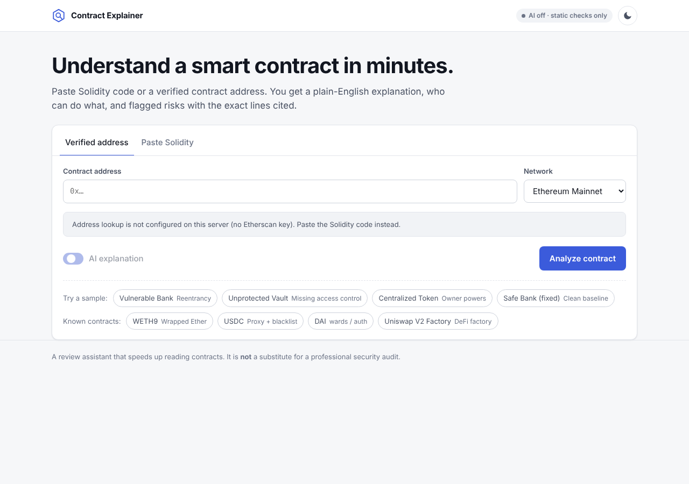
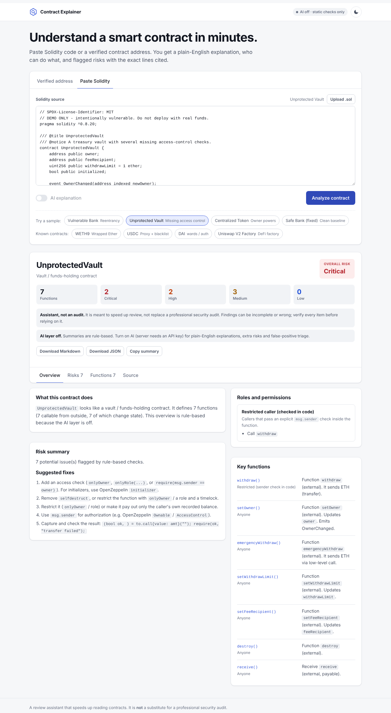
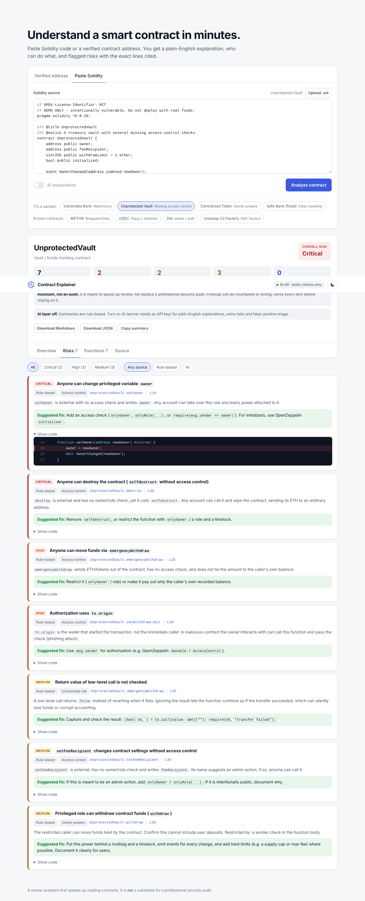

# AI Smart Contract Explainer

Paste Solidity code or a verified contract address and get a **plain-English explanation**, **who can do what**, and **flagged risks with the exact lines cited**.

> **Positioning:** this is a review assistant that speeds up reading and triaging contracts. It is **not** a replacement for a professional security audit.

<!-- Put the 60-second demo video / GIF here once recorded -->
**Live demo:** _add your deployed link here_ · **Demo video:** _add link here_



| Report overview | Risks with cited lines |
|---|---|
|  |  |

---

## What it does

1. **Input** a Solidity file (paste or upload), or an Etherscan-verified address on Ethereum, Sepolia, Polygon, Arbitrum, OP, Base or BNB Chain. Proxies (e.g. USDC) are followed to their implementation automatically.
2. **Splits** the code into contracts → functions / modifiers / state variables, keeping exact line numbers.
3. **Runs deterministic risk checks** (no AI, fully reproducible):
   | Check | What it flags |
   |---|---|
   | Reentrancy | External call (`.call`, token transfer, `safeTransferFrom`, `_safeMint`) followed by a state write, with no `nonReentrant` / `lock` guard |
   | Missing access control | Anyone can write `owner`/`admin`-like variables, `selfdestruct`, `delegatecall`, move funds, re-run an initializer, or call admin-named setters |
   | Unchecked owner powers | Privileged functions that can mint, blacklist/freeze, change fees, withdraw funds, pause, upgrade, or self-destruct (with severity lowered when a cap / max-fee bound exists) |
   | `tx.origin` auth | Authorization via `tx.origin` (phishing risk) |
   | Unchecked calls | Low-level `call` / `send` whose return value is ignored |
4. **AI review** (Gemini or Groq free tiers, local Ollama, Claude or OpenAI) of each function: a plain-English summary, who can call it, extra logic risks, and **triage of every rule-based finding** (confirmed / likely false positive / needs review).
5. **Report**: overview, roles and permissions, key functions, risks ranked by severity with suggested fixes, and a source viewer with highlighted lines. Export as Markdown or JSON.

### Guardrails against hallucination

- Rule-based findings are produced before the LLM and cannot be invented by it.
- The LLM only sees numbered code; any line it cites outside the function is clamped and labelled.
- Function ids the model invents are discarded; triage is only applied to real finding ids.
- The **overall risk** is computed deterministically from findings, not chosen by the model.
- Every report carries the "assistant, not an audit" disclaimer.

## Architecture

```
frontend/ (vanilla HTML/CSS/JS, served by FastAPI)
      │  POST /api/analyze
      ▼
app/main.py ── rate limit, size limit, LRU cache, security headers
      │
      ├─ etherscan.py   fetch verified source (API V2, multi-file + proxy aware)
      ├─ parser.py      mask comments/strings → split contracts/functions with line numbers
      ├─ static_checks.py   deterministic rules → findings S1..Sn
      ├─ llm.py         Anthropic + any OpenAI-compatible API (Gemini, Groq, Ollama, OpenAI), retries on 429
      ├─ analyzer.py    batch functions → LLM summaries + extra risks + triage → synthesis
      └─ report.py      Markdown export
```

| Layer | Stack |
|---|---|
| Backend | Python 3.11+, FastAPI, httpx, Pydantic |
| AI | Gemini / Groq (free tiers), Ollama (local), Claude or OpenAI, chosen by env var |
| Chain data | Etherscan API V2 (one key, many chains) |
| Frontend | Plain HTML/CSS/JS (no build step), light/dark, mobile-friendly |
| Deploy | Docker → Render (blueprint included) or any container host |

## Run locally

```bash
python -m venv .venv && source .venv/bin/activate      # Windows: .venv\Scripts\activate
pip install -r requirements-dev.txt
cp .env.example .env                                    # add ETHERSCAN_API_KEY and one AI key (GEMINI_API_KEY is free)
uvicorn app.main:app --reload
# open http://localhost:8000
```

Without any keys the app still works in **static-only mode** (paste code; rule-based checks and summaries).

### Choosing an AI provider (free options first)

| Provider | Cost | Get a key | `.env` |
|---|---|---|---|
| Google Gemini | Free tier, no card | https://aistudio.google.com/apikey | `GEMINI_API_KEY=...` |
| Groq | Free tier, no card | https://console.groq.com/keys | `GROQ_API_KEY=...` |
| Ollama (local) | Free, runs on your PC | https://ollama.com, then `ollama pull qwen2.5-coder:7b` | `LLM_PROVIDER=ollama` |
| Anthropic Claude | Paid API credit | https://console.anthropic.com | `ANTHROPIC_API_KEY=...` |
| OpenAI / OpenRouter | Paid (some free models on OpenRouter) | provider site | `OPENAI_API_KEY=...` (+ `OPENAI_BASE_URL`) |

With `LLM_PROVIDER=auto`, the first key found wins (Anthropic, then Gemini, Groq, OpenAI). Free tiers have per-minute and per-day limits: the app retries on HTTP 429 and lowers concurrency automatically, and setting `LLM_MAX_FUNCTIONS=15` keeps each analysis small. Check each provider's terms on whether free-tier prompts may be used for training; the sample contracts are public, so that's fine for a demo.

Run the tests:

```bash
pytest -q
```

## Deploy (live link)

**Render (free tier):** push this repo to GitHub → Render → *New* → *Blueprint* → select the repo. Add `ETHERSCAN_API_KEY` and your AI key (e.g. `GEMINI_API_KEY`) in the dashboard. `render.yaml` and `Dockerfile` are included.

Any other container host works the same way: `docker build -t contract-explainer . && docker run -p 8000:8000 --env-file .env contract-explainer`.

Cost controls (env vars): `RATE_LIMIT_PER_HOUR` (per IP), `LLM_MAX_FUNCTIONS` (functions sent to the model per analysis), `MAX_SOURCE_BYTES`. Results are cached in memory, so repeat demos of the same contract are free.

## API

| Method | Path | Description |
|---|---|---|
| `GET` | `/api/config` | AI status, supported chains, samples |
| `POST` | `/api/analyze` | `{ "source": "...", "filename": "A.sol" }` or `{ "address": "0x…", "chain": "mainnet" }`, plus `"use_ai": true` |
| `GET` | `/api/samples/{id}` | Sample contract source |
| `GET` | `/docs` | Interactive OpenAPI docs |

## Test contracts

| Contract | Expected result | Static-only output |
|---|---|---|
| [`VulnerableBank.sol`](samples/VulnerableBank.sol) | High: reentrancy in `withdraw` (lines 32–35) | [report](samples/outputs/VulnerableBank.md) |
| [`UnprotectedVault.sol`](samples/UnprotectedVault.sol) | Critical: anyone can `setOwner`, `destroy`; high: `emergencyWithdraw`, `tx.origin` | [report](samples/outputs/UnprotectedVault.md) |
| [`CentralizedToken.sol`](samples/CentralizedToken.sol) | Medium: owner can mint, blacklist, set fees; low: pause | [report](samples/outputs/CentralizedToken.md) |
| [`SafeBank.sol`](samples/SafeBank.sol) | Clean (the fixed bank) | [report](samples/outputs/SafeBank.md) |

Deploy these to Sepolia to test the address flow: see [docs/deploy-sepolia.md](docs/deploy-sepolia.md).

Well-known public contracts (one-click chips in the UI): WETH9, USDC (proxy), DAI (`wards`/`auth`), Uniswap V2 Factory. The parser and rules were also checked offline against the real Uniswap V2 Pair/Factory, WETH9 and OpenZeppelin ERC-20/Ownable sources.

## Limitations

- Heuristic rules, not a compiler-level analysis: cross-function and cross-contract reentrancy, inherited modifiers defined outside the fetched source, and state written through internal helpers can be missed.
- Some patterns are intentionally permissionless (e.g. Uniswap `skim`); they are flagged for review and the AI triage usually marks them as false positives.
- Large verified sources are capped: the AI reviews the most relevant `LLM_MAX_FUNCTIONS` functions (main contract and flagged functions first).
- In-memory rate limit and cache assume a single instance.

## License

MIT
